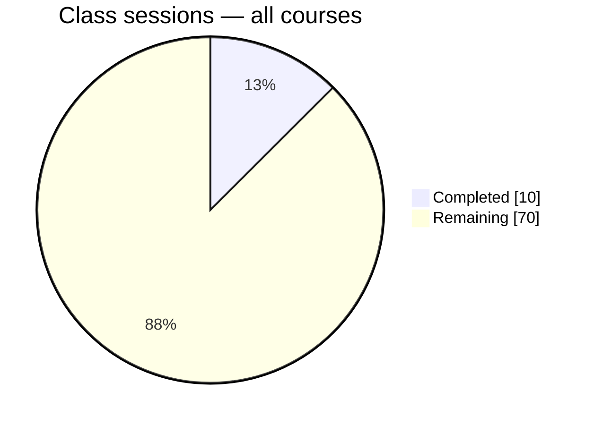

# Course Work — At-a-Glance Dashboard

**Student:** <name> · **<Programme, Institution>** · **Term <n>, AY <year> · <credits> credits**
**As of:** <date> · [Index](README.md) · **Schedule:** [<file>.xlsx](<file>.xlsx) · **Term runs** <start> → <end>

---

## The courses at a glance

| # | Course | Code | Instructor | Cr | Sessions | Done→Next | Status | Key assessment |
|---|--------|------|-----------|:--:|:--:|:--:|:--:|----------------|
| 1 | [<Course>](<slug>/) | <code> | Prof. <name> | 3 | <n> | <d> done → **<next> · <date>** | 🟡 | <assessment> |

**Legend:** ⬜ not started · 🟡 in progress · ✅ done

---

## 📈 Progress

### Classes completed
```
<CRS>   ██░░░░░░░░░░░░░░░░░░   10%    2 / 20
────────────────────────────────────────────
ALL     ███░░░░░░░░░░░░░░░░░   13%   10 / 80
```
<!-- bar = 20 chars, █ filled / ░ empty, 5% each -->



### Assignments & term projects
| Course | Tracker | Deliverables | In progress | Submitted | Graded | Marks secured |
|--------|---------|:--:|:--:|:--:|:--:|:--:|
| <CRS> | [tracker](<slug>/project-tracker.md) | <n> | 0 | 0 | 0 | 0 / 100% |

**Pipeline:** `Not started → Drafting → Submitted → Feedback → Reworking → Done`

---

## Next class day(s) — prep
| Date | Sessions | My prep |
|------|----------|---------|
| <date> | <sessions> | <what to do> |

## Things done
- <item>

## Things left to do (priority order)
1. <item>

## Full schedule
| Date | Day | Sessions |
|------|-----|----------|
| <date> | <day> | <sessions> |
